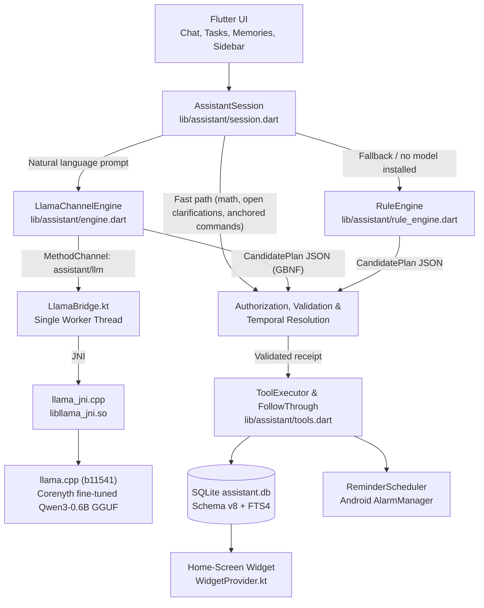

<p align="center">
  
</p>

<h1 align="center">Corenyth</h1>

<p align="center">
  <b>A local-first personal assistant that lives entirely on your Android phone.</b><br>
  Tasks, exact reminders, contextual follow-through, and personal memory—powered by an on-device LLM.<br>
  <i>No accounts. No cloud. No <code>INTERNET</code> permission.</i>
</p>

<p align="center">
  
  
  
  
  
  
</p>

<p align="center">
  <a href="#what-you-can-do-with-corenyth">What You Can Ask</a> •
  <a href="#how-it-works-the-model-interprets-code-acts">How It Works</a> •
  <a href="#quickstart-build--run">Quickstart</a> •
  <a href="#installing-an-on-device-model">Model Setup</a> •
  <a href="#debugging-testing--evaluation">Testing & Eval</a> •
  <a href="#project-structure">Project Structure</a> •
  <a href="#roadmap--known-limitations">Roadmap</a> •
  <a href="docs/README.md">Docs</a>
</p>

---

**Corenyth** is an Android-first personal assistant built with Flutter, Kotlin, and C++. It runs a quantized **Qwen3** language model directly on your phone's CPU through [llama.cpp](https://github.com/ggml-org/llama.cpp) (`libllama_jni.so`) to understand natural everyday messages—scheduling reminders, tracking tasks, checking in on meetings, and remembering personal facts—while storing everything in a local SQLite database and firing exact alarms through Android's `AlarmManager` even when the app is closed.

At the heart of Corenyth is one strict architectural rule: **the model interprets, code acts**. A small on-device model is never trusted to invent database IDs, calculate calendar dates, or mutate state directly. Instead, the model emits a GBNF grammar-constrained JSON plan using words grounded in your prompt. Application code validates that plan against what you actually typed and the current database state, resolves every timestamp deterministically, and executes the action—or falls back to a built-in deterministic rule engine if the model output is rejected or no model is installed.

> **Current Status — Early Prototype (`v0.1.0`)**
> Text chat, tasks, exact reminders, proactive follow-through, local FTS4 memory, the native home-screen widget, and on-device Qwen3 inference are built and running. However, **broad language reliability is not accepted yet**: on the latest frozen evaluation, the real Qwen3-0.6B model scored **97 pass / 0 fail / 5 incomplete** on development cases, but **12 pass / 18 fail / 4 incomplete** on unseen held-out phrasings. Voice (ASR/TTS) is not integrated yet. Since 20 October 2026 the model also writes a toned reply in the same call as its plan, and an optional fine-tuned 0.6B ([training/](training/README.md)) reads every message of a short phone script correctly; the corpus has not been rerun with either, and tone is still followed only loosely. See [reliability status](docs/development/reliability-status.md) and [roadmap & known limitations](#roadmap--known-limitations) for full details.

---

## Key Features

- **True On-Device LLM Inference:** Compiles [llama.cpp](https://github.com/ggml-org/llama.cpp) (pinned at `b11541`) from source with the Android NDK (`-O3` release optimization across all builds) into `libllama_jni.so`, bridged over JNI to a single native worker thread with KV-cache prefix reuse and streaming token generation.
- **Grammar-Constrained Safe Planning:** Restricts LLM output with a GBNF grammar to a structured semantic plan. Dart code checks authorization against your exact words, resolves relative and calendar dates, and writes through a crash-resilient operation journal.
- **Zero-Model & Fallback Rule Engine:** Includes a deterministic planner (`RuleEngine`) that emits the exact same plan structure. Corenyth remains usable before you download a model, on 32-bit devices, or whenever an LLM plan fails validation.
- **Exact Reminders & Boot Recovery:** Persists tasks and reminder plans in SQLite (schema `v8`) and schedules native Android `AlarmManager` alerts with lock-screen **Done** and **Snooze** actions. Missed or pending alerts are automatically reconciled on app startup, device reboot, clock shifts, and timezone changes.
- **Proactive Follow-Through:** Supports optional preparation nudges before timed events, post-meeting *"How did it go?"* outcome check-ins, daily recurring schedules, and an evening review before quiet hours—all landing naturally in your main chat thread.
- **Local Personal Memory (FTS4):** Captures explicit `"remember..."` notes and personal facts with full-text search (`SQLite FTS4`), provenance tracking, bounded corrections/supersession, and deletion—automatically feeding relevant memories into planning and reply prompts.
- **Home-Screen Widgets:** Choose a scrollable 4×2 remaining-task list with completion controls or a 2×2 animated companion. Both offer “+” to open a keyboard-focused assistant panel over the home screen, using the same prompt processing, clarification, and task tools as app chat. Display reads SQLite without starting Flutter; interactive chat starts Flutter and uses the installed model or rules fallback. See [widget behavior](docs/architecture/android-platform.md#widgets).
- **Cryptographically Verified Models:** Accepts exactly one GGUF file, Corenyth's fine-tuned Qwen3-0.6B, verifying exact byte size and streaming a background SHA-256 checksum check before the native loader ever touches the file.
- **Ethereal Arcana UI:** Crafted around an OLED pitch-black (`#000000`) and astral-violet (`#121016`) glassmorphic theme set in **Plus Jakarta Sans** (see [`branding/DESIGN.md`](branding/DESIGN.md)).

---

## What You Can Do with Corenyth

Once the app is running (with or without the local model loaded), you can interact with it naturally in chat:

| Category | Example Prompts You Can Type | What Corenyth Does |
|---|---|---|
| **Timed Reminders** | `"Remind me to call Kabir at 6pm"`<br>`"Can u remind me i have a meeting within 10 mins"`<br>`"Remind me tomorrow morning to renew my insurance"` | Creates the task, resolves the exact local timestamp (disclosing defaults like `9:00 AM` for *morning*, `3:00 PM` for *afternoon*, `7:00 PM` for *evening*), and arms an exact Android alarm. |
| **Tasks & Lists** | `"Add a task to buy groceries"`<br>`"What's pending for tomorrow?"`<br>`"Show my upcoming reminders"` | Captures untimed tasks or queries your live SQLite database to list open tasks, due dates, and scheduled alerts. |
| **Updates & Follow-Up** | `"I've called him"`<br>`"Mark buy groceries as done"`<br>`"Postpone my 6pm reminder by 30 minutes"` | Matches the referenced task or reminder from context (or asks a *"Which one?"* clarification that survives restarts), marks it complete, cancels future alerts, or reschedules the alarm. |
| **Clarifications** | Assistant: *"What time should I set the reminder for?"*<br>You: `"5:30pm"` | Persists open clarification questions across chat switches and app restarts so a bare time or target pick completes your earlier draft. |
| **Personal Memory** | `"Remember that Kabir prefers evening calls"`<br>`"What do you remember about Kabir?"`<br>`"Forget what I said about Kabir"` | Saves, searches, updates, or deletes personal facts in SQLite FTS4 and injects relevant memories into future replies. |
| **Instant Calculations** | `"What is 18% of 4250?"`<br>`"450 + 1280 - 320"` | Evaluates arithmetic directly in app code (`calculator.dart`) without invoking the LLM or creating a stray task. |

---

## Privacy & Offline by Design

Corenyth is built so your personal data cannot leave your phone:

- **No `INTERNET` Permission in Release Builds:** The release `AndroidManifest.xml` declares zero network permissions. *(Note: Flutter automatically injects `INTERNET` into `debug` and `profile` builds to support local hot-reload over ADB; always inspect `app-release.apk` when verifying offline guarantees.)*
- **User-Controlled Model Side-Loading:** The app never downloads weights in the background. You copy the fine-tuned GGUF once from your computer into `Documents/localmodels`.
- **100% Local State:** Tasks, reminder plans, chat history, and personal memories live exclusively inside your device's SQLite database (`assistant.db`). There is no cloud account, telemetry server, or remote API fallback.
- **Privacy-Preserving Diagnostics:** Native and session logs (`LlamaBridge`, turn diagnostics) record route selection, token counts, and inference timings—never your message text or personal memories.

---

## How It Works: The Model Interprets, Code Acts



Every turn flows through three guarded stages:

1. **Direct App Shortcuts:** If your message is pure arithmetic, answers an open clarification prompt (*"What time?"* or *"Which one?"*), or matches a high-confidence anchored command, `AssistantSession` handles it immediately.
2. **Grammar-Constrained Semantic Planning:** Otherwise, `LlamaChannelEngine` formats a KV-cache-friendly ChatML prompt and calls `assistant/llm` (`load`, `generate`, `cancel`, `unload`). `llama.cpp` samples a JSON `CandidatePlan` strictly constrained by a GBNF grammar. Every plan carries a short `reply` in the user's chosen tone: the chat answer, or a follow-up line added after the app's exact confirmation (e.g. *"What time is "meeting" on Sat 24 Oct? Ooh, what's the meeting about?"*).
3. **Authorization, Temporal Resolution & Execution:** Before anything touches the database, `authorization.dart` and `temporal.dart` verify that the proposed intent matches your words (distinguishing polite requests from questions, hypotheticals, and negations), compute exact wall-clock dates, and execute via `ToolExecutor`. If the LLM plan is invalid, Corenyth transparently falls back to `RuleEngine`.

For a deeper dive, read the [Architecture Overview](docs/architecture/overview.md), [Request Flow](docs/architecture/request-flow.md), [LLM Engine Guide](docs/architecture/llm-engine.md), and [Tools & Validation](docs/architecture/tools-and-validation.md).

---

## Tech Stack

| Layer | Technology |
|---|---|
| **Application & UI** | Flutter (Dart SDK `>=3.3.0 <4.0.0`), Material 3, *Ethereal Arcana* dark theme (`Plus Jakarta Sans`) |
| **Android Native** | Kotlin (`JVM 17`), C++17 JNI (`llama_jni.cpp`), CMake `3.22.1`, Android NDK |
| **On-Device Inference** | [llama.cpp](https://github.com/ggml-org/llama.cpp) pinned tag `b11541`, static `ggml`, CPU-only (`armv8-a` baseline on arm64, `x86_64` on emulator, no OpenMP) |
| **Allowlisted Model** | `Corenyth-Qwen3-0.6B-tuned-Q4_0.gguf`: [Qwen3-0.6B](https://huggingface.co/Qwen/Qwen3-0.6B) LoRA-fine-tuned on Corenyth's plan prompts ([training/](training/README.md)) |
| **Database & Search** | SQLite via `sqflite` (schema `v8`, WAL enabled), `FTS4` full-text memory indexing, `sqflite_common_ffi` for desktop tests |
| **Alarms & Background** | Native Android `AlarmManager` (`ProactiveReceiver` in `:proactive` process), `flutter_local_notifications` |
| **Core Packages** | `crypto` (streaming SHA-256 model verification), `timezone`, `flutter_markdown_plus`, `path` |

---

## Quickstart: Build & Run

### Prerequisites

**Target Android Device (or Emulator)**
- **Architecture:** 64-bit Android phone (`arm64-v8a`) or `x86_64` Android emulator. *(On 32-bit devices, the native library is omitted and the app runs cleanly on the deterministic rule engine.)*
- **OS Version:** Android 7.0 Nougat (`API 24`) or newer.
- **Free Storage:** ~364 MiB for the fine-tuned model.

**Development Machine**
- **Flutter SDK:** Stable channel (developed with Flutter `3.47.7`, Dart `>=3.3.0`).
- **Java:** JDK 17.
- **Android Studio / SDK:**
  - `Android SDK Platform` 34 or newer (`compileSdk = 34`).
  - `NDK (Side by side)` matching your Flutter version's `flutter.ndkVersion`.
  - `CMake` **3.22.1** (install via *SDK Manager → SDK Tools → Show Package Details*).
- **Git:** Required to fetch the pinned `llama.cpp` source tree.

Make sure your Android licenses are accepted and your toolchain is healthy:

```sh
flutter doctor --android-licenses
flutter doctor -v
```

### Step 1: Clone the Repository & Fetch `llama.cpp`

`llama.cpp` is not committed to this repository. Instead, CMake expects it at `android/app/src/main/cpp/llama.cpp` (which is gitignored) at pinned tag `b11541`:

```sh
# 1. Clone Corenyth
git clone https://github.com/Souvik8426/Corenyth.git
cd Corenyth

# 2. Fetch the exact pinned llama.cpp release into the JNI source tree
git clone --depth 1 --branch b11541 https://github.com/ggml-org/llama.cpp android/app/src/main/cpp/llama.cpp
```

> **Tip:** If you skip the second `git clone`, the Gradle/CMake configuration step will fail immediately and print the exact clone command above.

### Step 2: Install Dependencies, Analyze & Run Tests

You can run the full Dart and Flutter test suite (400+ unit, widget, SQLite migration, and regression tests) right on your machine without an Android device attached:

```sh
# Fetch Dart packages
flutter pub get

# Run static analysis (must report 0 issues)
flutter analyze

# Run the unit, widget, and FFI SQLite test suite
flutter test
```

### Step 3: Build the APK or Run on Your Phone

Connect an Android phone with **USB Debugging** enabled (verify with `adb devices`) or launch an `x86_64` emulator:

```sh
# Run directly on a connected device or emulator
flutter run

# Or build standalone APKs (written to build/app/outputs/flutter-apk/):
flutter build apk --debug
flutter build apk --release
```

**Important Build Notes:**
- **First Build Duration:** The initial Gradle build downloads Gradle `9.3.1` (~235 MB) and compiles `llama.cpp` from C++ source, which takes several minutes. *(If a network drop interrupts the Gradle download, delete the partial folder inside `~/.gradle/wrapper/dists/gradle-9.3.1-all/` and retry.)*
- **Always-Optimized Native Code:** `CMakeLists.txt` compiles `llama.cpp` with `-O3` (`Release`) even in `--debug` builds, because unoptimized CPU inference is roughly 50× slower.
- **Release Signing:** Release builds currently use the debug signing config in `android/app/build.gradle.kts` so you can side-load `app-release.apk` immediately (`adb install build/app/outputs/flutter-apk/app-release.apk`).

---

## Installing an On-Device Model

Because Corenyth has no `INTERNET` permission, it never downloads model files behind the scenes. You place the `.gguf` file into `Documents/localmodels` yourself.

### Allowlisted Model

Only one GGUF file is accepted (the stock Qwen3 0.6B/1.7B files and any other GGUF are rejected):

| Filename (Keep Exact Name) | Exact Size | SHA-256 Checksum | Where it comes from |
|---|---|---|---|
| `Corenyth-Qwen3-0.6B-tuned-Q4_0.gguf` | `381,566,560` bytes (~364 MiB) | `77d3f6d469a6d5069a86980ec61f77bd0fb8b937b56d4fac0362659ca6c7b821` | Built with [training/](training/README.md) (Colab export `Qwen3-0.6B.Q4_0.gguf`, renamed) |

A retrained model has a new size and hash: update `corenythModel` in `lib/services/model_status.dart` with each export.

### Setup Instructions

1. **Launch Corenyth Once:** Open the app on your phone and grant storage access when prompted (*All files access* on Android 11+, or *Storage permission* on Android 7–10). This automatically creates `/sdcard/Documents/localmodels/`.
2. **Place the Model File** from your computer:
   ```sh
   adb push Qwen3-0.6B.Q4_0.gguf /sdcard/Documents/localmodels/Corenyth-Qwen3-0.6B-tuned-Q4_0.gguf
   ```
   (Or copy it to the phone any other way and move it into `Documents/localmodels/` with the **Files** app, using exactly that name.)
3. **Verify & Load:** Return to Corenyth. The app checks the file size, computes its SHA-256 hash in a background isolate on first load (caching the verification result by size and modification timestamp), and loads the model into memory. If verification or loading fails, Corenyth uses the built-in `RuleEngine` and shows the reason in the status chip.

See the [Model Install Guide](docs/guides/model-install.md) for full details on verification caching and fallback markers.

---

## Android Permissions Explained

| Permission | Scope | Why Corenyth Needs It |
|---|---|---|
| `MANAGE_EXTERNAL_STORAGE` *(Android 11+)*<br>`WRITE_EXTERNAL_STORAGE` *(Android 7–10)* | Storage | Reads the `.gguf` model file you placed in `Documents/localmodels` (files created by a browser or `adb` in shared storage are otherwise hidden from scoped-storage apps). |
| `POST_NOTIFICATIONS` | Notifications | Displays reminder alerts, preparation nudges, and follow-through check-ins with **Done** and **Snooze** buttons. |
| `SCHEDULE_EXACT_ALARM` | Alarms | Schedules exact wall-clock reminders via `AlarmManager` so alerts fire on time even in Doze mode. |
| `RECEIVE_BOOT_COMPLETED` | Boot / Time | Re-arms scheduled alarms and reconciles missed reminders after a phone reboot, app update, clock adjustment, or timezone change. |
| `RECORD_AUDIO` | Microphone | Reserved in the manifest for upcoming on-device voice recognition (`sherpa-onnx`); **never requested at runtime** in `v0.1.0`. |

---

## Debugging, Testing & Evaluation

### 1. Live On-Device Logs

Monitor model load times, KV-cache reuse, prompt/generation token speeds, and native `llama.cpp` diagnostics over `adb`:

```sh
adb logcat -s LlamaBridge llama.cpp
```

### 2. Interpreter Modes & Release Verification

Corenyth supports both the default legacy interpreter and an opt-in unified coordinator (`CORENYTH_INTERPRETER=unified`), plus reproducible source-manifest stamping for release verification:

```sh
# Run the test suite under the unified interpreter contract
flutter test --dart-define=CORENYTH_INTERPRETER=unified

# Validate the frozen evaluation corpus schema and SHA-256 freeze manifest
python3 -I eval/validate.py --summary

# Compute the working-tree source manifest identity and stamp a release APK
python3 -I eval/source_manifest.py
flutter build apk --release --dart-define=CORENYTH_GIT_SHA=<printed-identity>
```

### 3. Running the Frozen Evaluation Corpus (`eval/`)

The `eval/` directory contains a frozen benchmark (`102` single-turn dev cases, `34` held-out variants, and `23` multi-turn scenarios) evaluated against real production SQLite state:

```sh
# Run the development corpus against the deterministic rule engine (model unavailable)
TZ=Asia/Kolkata flutter test test/reliability_corpus_test.dart --dart-define=CORENYTH_EVAL=true

# Score the recorded state against expected database mutations
python3 -I eval/score.py eval/results/rules-dev.json
```

To evaluate with real host-CPU Qwen3 inference via `eval/native_host.cpp`, see [`eval/README.md`](eval/README.md) and the [Build & Run Guide](docs/guides/build-and-run.md).

---

## Project Structure

```text
Corenyth/
├── lib/
│   ├── main.dart                  # App entry point, navigation shell, model setup cards & dialogs
│   ├── assistant/                 # Core intelligence layer:
│   │   ├── session.dart           #   Conversation state machine, routing, clarifications, diagnostics
│   │   ├── engine.dart            #   LlmEngine interface, ChatML prompt builder, LlamaChannelEngine
│   │   ├── rule_engine.dart       #   Deterministic fallback planner (same CandidatePlan output)
│   │   ├── authorization.dart     #   Request authorization & user-word grounding checks
│   │   ├── temporal.dart          #   Typed relative & calendar date/time resolution
│   │   ├── tools.dart             #   Tool schemas, GBNF grammar, validation & ToolExecutor
│   │   └── follow_through.dart    #   Meeting outcomes, prep nudges, daily schedules & evening review
│   ├── data/                      # SQLite schema v8 (db.dart), FTS4 memory search & repositories (repos.dart)
│   ├── services/                  # Composition root, model catalog & SHA-256 verifier, alarm scheduler, native bridge
│   ├── ui/                        # Chat view, history sidebar, Tasks page, Memories page & model status UI
│   └── theme/                     # Ethereal Arcana color tokens and typography
├── android/app/src/main/
│   ├── cpp/                       # CMakeLists.txt, llama_jni.cpp & gitignored llama.cpp/ checkout
│   └── kotlin/com/corenyth/assistant/
│                                  # MainActivity, LlamaBridge, WidgetProvider, Proactive, VoiceSessionActivity
├── test/                          # 400+ unit, widget, FFI SQLite migration & regression tests
├── eval/                          # Frozen JSONL evaluation corpus, schema validator, scorer & native host runner
├── training/                      # Qwen3-0.6B fine-tune: MASSIVE-based dataset builder & Colab training cells
├── docs/                          # Architecture deep dives, setup guides, reliability status & ADRs
├── branding/                      # Corenyth logo and Ethereal Arcana DESIGN.md specification
└── assets/fonts/                  # Bundled Plus Jakarta Sans typeface (Regular through ExtraBold)
```

> **Note:** Keep the Android package name and namespace set to `com.corenyth.assistant`—both the Kotlin package structure and the C++ JNI symbol signatures in `llama_jni.cpp` depend on it.

---

## Documentation Index

All architectural and operational documentation lives in [`docs/`](docs/README.md):

- **Architecture:** [Overview](docs/architecture/overview.md) • [Request Flow](docs/architecture/request-flow.md) • [LLM Engine](docs/architecture/llm-engine.md) • [Tools & Validation](docs/architecture/tools-and-validation.md) • [Data Model (SQLite v8)](docs/architecture/data-model.md) • [Android Platform & Widget](docs/architecture/android-platform.md)
- **Guides:** [Build, Test & Run](docs/guides/build-and-run.md) • [Model Install & Verification](docs/guides/model-install.md)
- **Development & Quality:** [Reliability Status](docs/development/reliability-status.md) • [Known Gaps](docs/development/known-gaps.md) • [Device Evaluation](docs/development/device-evaluation.md) • [Performance Validation](docs/development/performance-validation.md) • [Follow-Through Device Checklist](docs/development/follow-through-device-checklist.md)
- **Design & Product Decisions:** [Ethereal Arcana Design System](branding/DESIGN.md) • [Expectation Gap Report](docs/decisions/expectation-gap-report.md) • [Follow-Through Implementation](docs/decisions/follow-through-implementation.md)

---

## Roadmap & Known Limitations

Being transparent about what works today and what is still in progress:

- **Held-Out Language Generalization (Top Priority):** While the real Qwen3-0.6B model passes development cases (`97 pass / 0 fail / 5 incomplete`), unseen held-out phrasing currently scores `12 pass / 18 fail / 4 incomplete`. Improving semantic generalization across task updates, scheduling, and memory without weakening the validation layer is the primary engineering focus. A LoRA fine-tune of 0.6B ([training/](training/README.md)) is the current approach; it has not yet been scored on the frozen corpus.
- **Tone-Following Replies:** The model now writes the reply line itself, but the 0.6B (stock or fine-tuned) follows the selected tone only loosely. Larger, mutually exclusive tone examples in the next training round are planned.
- **Larger Models:** The stock Qwen3 0.6B and 1.7B are no longer selectable; only the fine-tuned 0.6B loads. A fine-tuned 1.7B would need its own training run, allowlist entry and on-phone RAM/latency check.
- **Voice Input & Output (`sherpa-onnx`):** Streaming VAD/ASR speech recognition, local TTS playback, and voice barge-in interruption are planned next.
- **Extended Date Expressions:** Phrases like *"today/tonight/tomorrow"*, *"morning/afternoon/evening"*, *"in N minutes/hours"*, weekdays, and named month dates work today. Relative expressions like *"next Friday"*, *"next week"*, or *"in 2 weeks"* are not parsed yet—Corenyth asks you for a specific date/time rather than guessing.
- **Vector Embeddings / Mem0:** Personal memory currently uses local SQLite `FTS4` ranked by importance and recency. The `embedding` column in `memories` is reserved for future semantic search.
- **ARMv8.2 Dot-Product Kernels:** Native builds currently target baseline `armv8-a` for compatibility across all 64-bit Android phones; optional `armv8.2-a+dotprod` kernels are planned for faster prompt processing on modern SoCs.
- **Google Play Store Distribution:** Side-loading works out of the box. Publishing to Google Play will require either a `MANAGE_EXTERNAL_STORAGE` declaration or migrating model import to Android's Storage Access Framework (`ACTION_OPEN_DOCUMENT`).

See [Known Gaps](docs/development/known-gaps.md) for the complete technical breakdown.

---

## Contributing

Issues and pull requests are welcome! Before submitting a PR:

1. **Keep Checks Green:** Run `flutter analyze` and `flutter test` (both default and `--dart-define=CORENYTH_INTERPRETER=unified`) and ensure zero warnings or failures.
2. **Preserve the Core Boundary:** The LLM may only propose a semantic plan. Never let model output pick raw database IDs, compute timestamps, or bypass `authorization.dart` and `ToolExecutor`.
3. **Protect the Frozen Corpus:** Do not modify files in `eval/corpus/` to make tests pass, and never inspect or tune prompts/grammars against `eval/corpus/single_heldout.jsonl`. Verify corpus integrity with `python3 -I eval/validate.py --summary`.
4. **Keep Docs in Sync:** Update the relevant guide in [`docs/`](docs/README.md) whenever behavior, schema versions, or workflows change.

---

## License & Acknowledgements

- **Repository License:** No open-source license file has been added to this repository yet (all rights reserved by default until a license is chosen).
- **Third-Party Components:**
  - [llama.cpp](https://github.com/ggml-org/llama.cpp) by `ggml-org` (MIT License)
  - [Qwen3](https://huggingface.co/Qwen) by the Qwen team, with quantized GGUF weights by [Unsloth](https://huggingface.co/unsloth)
  - [Plus Jakarta Sans](https://github.com/tokotype/PlusJakartaSans) by Tokotype (SIL Open Font License 1.1 — see [`assets/fonts/OFL.txt`](assets/fonts/OFL.txt))
