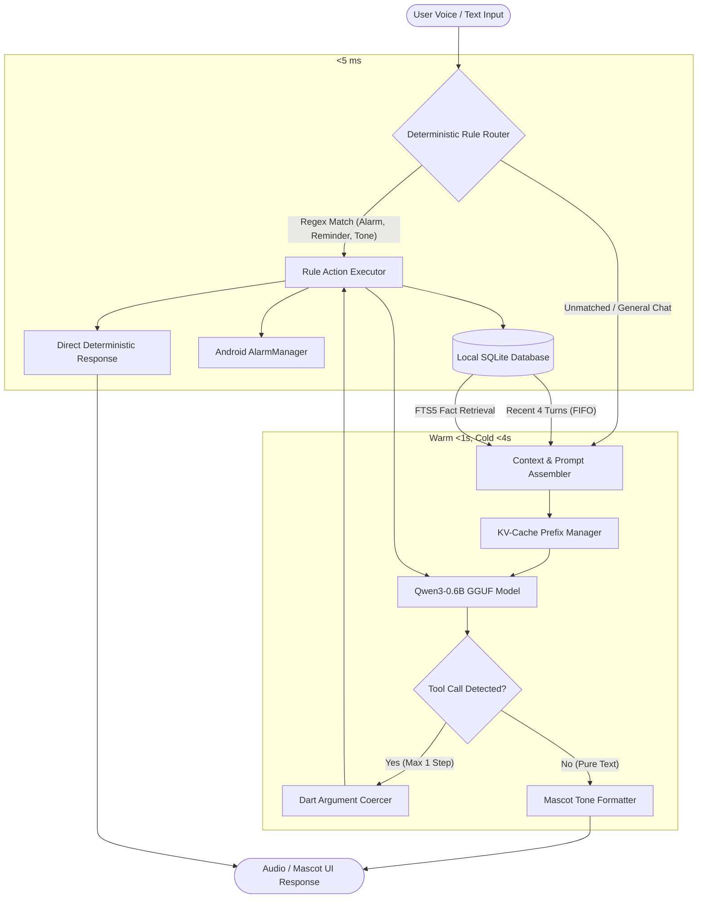

# Architecture Study: Knowledge Extraction from Mem0 and Hermes Agent for Corenyth

> Implementation status (29 October 2026): this study contains proposals and estimated gains. Use [current next steps and checkpoint](architecture-next-steps.md) and [reliability status](reliability-status.md) for implemented behavior and measured results. Production retains FTS4; the full study roadmap is not complete.

## Executive Summary (10 Lines)
1. **Corenyth's Core Dilemma**: Running an offline 0.6B model on phones requires ruthless context thrift and deterministic safety rails.
2. **Mem0's Core Asset**: Memory is stored as discrete, self-contained declarative facts rather than raw conversation transcripts.
3. **Fact Extraction Mechanics**: Relative dates must be deterministically grounded to observation timestamps before storage to avoid ambiguity.
4. **Declarative vs. Imperative Pitfall**: Memories must be declarative facts ("User prefers X"), never directives ("Always do X"), to prevent goal hijacking.
5. **Hermes' Turn-Phase Architecture**: Splitting the execution loop into discrete lifecycle steps prevents unhandled crashes and enables safe recovery.
6. **Prompt Caching Structure**: Layering prompts into Static Identity, Context/Tools, and Dynamic Volatile Memory maximizes token reuse.
7. **Context Compaction Hierarchy**: Aggressively prune verbose tool outputs first before summarizing middle conversational turns.
8. **Anti-Hijack Guardrails**: Compacted context summaries must carry explicit reference-only framing so the model does not repeat completed tasks.
9. **Rule-First Routing**: Fast regex/grammar matchers should resolve commands in <5 ms, reserving the 0.6B model solely for conversational flow.
10. **Zero Cloud Infrastructure**: Corenyth can replicate these benefits with pure Dart and local SQLite (FTS5 + JSON1) with zero vector DB servers.

---

## Part A: Mem0 — Memory and Context Management

### Knowledge Card A1: The Scoped Memory Item and Data Model
* **Name**: Multi-Tenant Scoped Memory Entity
* **Problem It Solves**: Raw conversational history grows unbounded and mixes distinct contexts (user traits, temporary session banter, and agent configuration). Without strict isolation and structured schemas, queries return irrelevant context that overflows tiny context windows.
* **Core Idea**: A memory is not a chat log; it is an atomic, self-contained factual assertion with strict metadata boundaries. Memories are partitioned into three explicit scopes: `user_id` (permanent user traits across sessions), `agent_id` (system persona guidelines), and `run_id` (short-lived session context).
* **Implementation**:
  * Found in `mem0/configs/base.py` (`MemoryItem`) and `mem0/memory/main.py` (`_build_filters_and_metadata`, `_strip_identity_keys`, `_validate_and_trim_entity_id`, `_build_session_scope`).
  * Each memory record consists of:
    * `id`: Unique string UUID identifying the atomic fact.
    * `data` (or `memory`): Natural language fact string (e.g., *"User prefers dark mode"*).
    * `hash`: MD5/SHA256 hex digest of the text string for $O(1)$ duplicate detection without embedding lookups.
    * `user_id`, `agent_id`, `run_id`: Scoping keys.
    * `created_at` and `updated_at`: UTC ISO-8601 timestamps.
    * `expiration_date`: Optional date string (`YYYY-MM-DD`) after which the memory automatically expires.
    * `metadata`: Free-form key-value store for domain-specific tags.
  * In `mem0/memory/main.py` (`_strip_identity_keys`), caller-supplied metadata is explicitly sanitized to prevent user-supplied payloads from maliciously re-scoping memories into another user or tenant.
* **Decision Rules and Thresholds**:
  * At least one scope identifier (`user_id`, `agent_id`, or `run_id`) is strictly required (`VALIDATION_001` in `_build_filters_and_metadata`).
  * Empty or whitespace-only entity IDs are rejected.
  * Payloads where `expiration_date < today_utc()` are automatically filtered out during retrieval unless `show_expired=True` is explicitly passed (`_payload_is_expired`).
* **Trade-offs and Failure Modes**:
  * *Trade-off*: Fine-grained atomicity creates many small records instead of one continuous narrative. It requires secondary consolidation.
  * *Failure Mode*: If scope keys are loosely managed or omitted, memories leak across conversation threads or pollute global state.
* **Corenyth Takeaway (ADOPT with Simplification)**:
  * Adopt this data model completely in local SQLite. Corenyth needs only two scopes: `global` (durable user preferences and facts) and `session` (active task context).
  * Do not use external vector servers. A simple SQLite table with `id`, `fact`, `category`, `created_at`, `expires_at`, and `hash` is sufficient.

---

### Knowledge Card A2: Phased Ingestion and Extraction Pipeline
* **Name**: Phased Batch Add Flow
* **Problem It Solves**: Ingesting raw multi-turn dialogue into long-term storage causes severe bloat. Many turns are filler ("okay", "thanks"), while others contain multiple distinct facts mixed across sentences.
* **Core Idea**: Ingestion separates message storage from fact extraction. The system logs raw messages to a lightweight history table first, retrieves existing candidate memories to prevent duplication, extracts only context-rich declarative facts, and executes a single atomic batch insert.
* **Implementation**:
  * Found in `mem0/memory/main.py` (`add` lines 761–880, `_add_to_vector_store` lines 881–1220).
  * Pipeline phases:
    1. *Phase 0 (Context Gathering)*: Fetch recent messages (up to 10) from SQLite to resolve pronouns and references.
    2. *Phase 1 (Candidate Retrieval)*: Query existing memories relevant to the new input.
    3. *Phase 2 (LLM Extraction)*: Send input messages + existing memories + observation date to the extraction prompt.
    4. *Phase 3 & 4 (Processing & Hashing)*: Compute MD5 content hashes of newly extracted candidate facts.
    5. *Phase 5 (Hash Deduplication)*: Filter out any extracted text whose hash matches an existing record or an earlier entry in the current batch.
    6. *Phase 6 (Batch Persistence)*: Insert surviving facts into storage within a single database transaction.
    7. *Phase 7 (Audit Logging)*: Record the `ADD` event in SQLite history.
    8. *Phase 8 (Message Persistence)*: Append the raw conversation turn to SQLite history via `db.save_messages()`.
* **Decision Rules and Thresholds**:
  * Hash deduplication is evaluated before any costly secondary processing.
  * If the extraction LLM fails or extracts nothing, raw messages are still saved to SQLite (`save_messages`), ensuring no chat logs are lost.
* **Trade-offs and Failure Modes**:
  * *Trade-off*: Requiring an extraction pass adds processing time and token consumption.
  * *Failure Mode*: In high-latency models, running extraction synchronously stalls the conversation.
* **Corenyth Takeaway (ADAPT to Asynchronous Background Execution)**:
  * Running an extraction prompt on a 0.6B model during user interaction would double response latency (adding 15–20 seconds).
  * Corenyth must decouple memory extraction from chat responses. When a user sends a message, generate the reply immediately. If the message contains rule-detectable facts ("My mom's birthday is June 4", "Call me Alex"), extract them deterministically via regex. For open-ended facts, enqueue extraction as an idle background task or run simple rule heuristics.

---

### Knowledge Card A3: Semantic Action Resolution (ADD vs. UPDATE vs. DELETE vs. NOOP)
* **Name**: Quad-Action Memory Reconciliation
* **Problem It Solves**: Human preferences and schedules evolve. Storing every statement causes contradictory entries (e.g., both "User loves coffee" and "User quit caffeine" existing simultaneously), confusing the model.
* **Core Idea**: When new facts arrive, the system compares them against existing matching memories and selects one of four explicit actions: `ADD` (new independent fact), `UPDATE` (evolved or more detailed version of an existing fact), `DELETE` (direct contradiction or revocation), or `NONE`/`NOOP` (identical or less informative than what is already stored).
* **Implementation**:
  * Found in `mem0/configs/prompts.py` (`DEFAULT_UPDATE_MEMORY_PROMPT`, `get_update_memory_messages`).
  * The prompt provides strict operational guidelines and few-shot JSON examples:
    * *ADD*: Retrieval fact contains new info not present in memory.
    * *UPDATE*: New fact conveys the same core subject with superior detail ("Loves cricket with friends" replaces "Likes cricket"), or modifies an active state. The existing memory ID is strictly preserved.
    * *DELETE*: New fact directly negates prior memory ("Dislikes cheese pizza" invalidates "Loves cheese pizza").
    * *NONE*: New fact conveys identical meaning ("Likes cheese pizza" vs "Loves cheese pizza").
* **Decision Rules and Thresholds**:
  * When updating, the ID must be reused, never regenerated.
  * In Mem0 V3 additive extraction, explicit `DELETE` calls are minimized in favor of linking new memories to older ones (`linked_memory_ids`) to preserve historical lineage unless explicitly contradicted.
* **Trade-offs and Failure Modes**:
  * *Trade-off*: Relies on model discernment to recognize subtle contradictions and avoid spurious deletions.
  * *Failure Mode*: Small models (<3B parameters) struggle with complex four-way JSON decision prompts, frequently returning hallucinated IDs, malformed JSON, or dropping valid memories.
* **Corenyth Takeaway (ADAPT to Keyed Entity Slots)**:
  * Do NOT ask Qwen3-0.6B to output multi-action JSON with arbitrary UUIDs; it will fail the schema or hallucinate IDs.
  * Instead, adapt this into deterministic **Keyed Entity Slots** in SQLite. Define explicit categories: `preference:coffee`, `profile:name`, `setting:tone`. When a new value arrives for an existing key, execute an `UPDATE` automatically. For general unstructured notes, store them chronologically and use `timestamp DESC` recency ordering.

---

### Knowledge Card A4: Temporal Grounding and Relative Date Anchoring
* **Name**: Observation-Date Temporal Anchoring
* **Problem It Solves**: Users speak in relative terms: "call doctor tomorrow", "had a meeting yesterday", "leaving next Sunday". If stored verbatim, "User had a meeting yesterday" becomes useless and misleading two weeks later.
* **Core Idea**: Every conversation turn is anchored to a concrete, immutable `Observation Date`. All relative temporal references must be mathematically converted to absolute calendar dates before being persisted to memory.
* **Implementation**:
  * Found in `mem0/configs/prompts.py` (`ADDITIVE_EXTRACTION_PROMPT` lines 524–542, `_resolve_dates` lines 1007–1015).
  * System prompts explicitly distinguish two temporal values:
    * `Observation Date`: The exact date the conversation occurred (e.g., `2026-10-29`).
    * `Current Date`: Today's system date when memory extraction runs.
  * Decision rules embedded in prompt guidelines:
    * "yesterday" $\rightarrow$ `Observation Date - 1 day`.
    * "last week" $\rightarrow$ week preceding `Observation Date`.
    * "next month" $\rightarrow$ month following `Observation Date`.
    * "on Sunday" $\rightarrow$ compute exact upcoming calendar Sunday from `Observation Date`.
  * Explicit prohibition: Verbatim relative expressions like "recently", "two days ago", or "next week" are banned from stored text unless accompanied by the absolute date.
* **Decision Rules and Thresholds**:
  * If `observation_date` is omitted, it defaults to the system UTC timestamp.
  * Stored facts must state exact calendar dates (e.g., "User scheduled a vet appointment for March 14, 2026", never "User scheduled a vet appointment for tomorrow").
* **Trade-offs and Failure Modes**:
  * *Trade-off*: Requires reliable clock access and explicit date math.
  * *Failure Mode*: If the system passes `Current Date` instead of `Observation Date` during batch processing of older conversations, dates are computed with massive offsets.
* **Corenyth Takeaway (ADOPT with High Priority)**:
  * This directly solves Corenyth's bug where "call on Sunday" defaults incorrectly to 9 AM on an arbitrary date.
  * In Corenyth, implement a deterministic Dart date-time parser. When the user says "Sunday", Dart calculates the exact date (`DateTime.now().add(daysUntilSunday)`). Feed the resolved absolute date into the rule engine and model prompt, eliminating ambiguity.

---

### Knowledge Card A5: Hybrid Search with Adaptive BM25 and Entity Boosting
* **Name**: Tri-Factor Hybrid Search
* **Problem It Solves**: Pure semantic vector search suffers from semantic dilution: rare proper nouns, specific codes, phone numbers, or exact names get buried by vaguely related semantic embeddings. Pure keyword search (BM25) misses synonyms and conceptual paraphrasing.
* **Core Idea**: Combine semantic dense vector similarity, keyword BM25 lexical matching, and exact entity graph links into a single composite score. Weight the signals adaptively based on query length and gate candidates behind a strict semantic relevance threshold.
* **Implementation**:
  * Found in `mem0/memory/main.py` (`_search_vector_store` lines 1642–1745) and `mem0/utils/scoring.py` (`get_bm25_params`, `normalize_bm25`, `score_and_rank`).
  * Process:
    1. *Semantic Candidate Pool*: Fetch top-$4K$ candidates via vector similarity.
    2. *Keyword BM25*: Fetch lexical matches using lemmatized query tokens.
    3. *Adaptive Sigmoid Normalization*: Normalize raw unbounded BM25 scores (typically 0–25) into $[0, 1]$ via a logistic sigmoid function:
       $$\text{score}_{\text{norm}} = \frac{1}{1 + e^{-\text{steepness} \cdot (\text{raw} - \text{midpoint})}}$$
       Sigmoid parameters adjust dynamically based on token count (e.g., query $\le 3$ terms uses midpoint 5.0, steepness 0.7; query $> 15$ terms uses midpoint 12.0, steepness 0.5).
    4. *Additive Scoring*:
       $$\text{Combined} = \frac{\text{Semantic} + \text{BM25} + \text{EntityBoost}}{\text{MaxPossible}}$$
       where `EntityBoost` is weighted at 0.5 for exact entity graph overlaps.
    5. *Hard Semantic Gating*: Any candidate scoring below the semantic threshold (default 0.1) is discarded immediately, preventing irrelevant keyword hits from surfacing.
* **Decision Rules and Thresholds**:
  * Hard gate: `candidate.score >= threshold` before combining.
  * Over-fetch factor: `internal_limit = max(limit * 4, 60)` to ensure sufficient candidates for hybrid re-ranking.
* **Trade-offs and Failure Modes**:
  * *Trade-off*: Requires maintaining both an inverted keyword index and a vector index, consuming RAM and storage.
  * *Failure Mode*: If BM25 normalization parameters are poorly tuned, keyword matches completely drown out semantic intent or vice versa.
* **Corenyth Takeaway (ADAPT to SQLite FTS5 + Recency Weighting)**:
  * Corenyth cannot run heavy local vector databases or embedding models in RAM alongside Qwen3-0.6B without causing out-of-memory (OOM) crashes on low-end Android phones.
  * Adapt this by using SQLite's built-in **FTS5 (Full-Text Search)** extension. FTS5 provides fast BM25 ranking out of the box with zero RAM overhead. Add a simple recency decay score in SQL:
    $$\text{FinalScore} = \text{bm25}(match) \times 0.7 + \text{recency\_boost} \times 0.3$$
  * This provides 90% of hybrid search quality with zero additional neural models or vector servers.

---

### Knowledge Card A6: Transactional History and Message Audit Logging
* **Name**: Dual-Table Audit and Message Store
* **Problem It Solves**: In-place modification of memories without an audit trail leads to irreversible data loss when extractions make mistakes. Furthermore, debugging memory drift across turns is impossible without tracking state transitions.
* **Core Idea**: Separate mutable working state from immutable audit history. Store the active memories in one index, while logging every mutation event (`ADD`, `UPDATE`, `DELETE`) with predecessor snapshots in a persistent SQLite transaction log.
* **Implementation**:
  * Found in `mem0/memory/storage.py` (`SQLiteManager` lines 11–347).
  * Two distinct SQLite tables:
    * `history`: Records `id`, `memory_id`, `old_memory`, `new_memory`, `event`, `created_at`, `updated_at`, `is_deleted`, `actor_id`, `role`.
    * `messages`: Buffers recent conversational turns by `session_scope`.
  * Retention Pruning Rule: In `save_messages()`, after inserting new turns, an automatic eviction query deletes messages older than the 10 most recent turns for that session scope:
    ```sql
    DELETE FROM messages WHERE session_scope = ? AND id NOT IN (
        SELECT id FROM (
            SELECT id FROM messages WHERE session_scope = ? ORDER BY created_at DESC LIMIT 10
        )
    )
    ```
* **Decision Rules and Thresholds**:
  * All mutations use explicit SQLite transactions (`BEGIN` ... `COMMIT`/`ROLLBACK`).
  * Rolling message memory is capped at a hard limit of 10 turns.
* **Trade-offs and Failure Modes**:
  * *Trade-off*: History tables consume disk space over time if not vacuumed.
  * *Failure Mode*: Unindexed text columns in SQLite cause table scans when querying history for large databases.
* **Corenyth Takeaway (ADOPT Directly)**:
  * Implement identical table designs in Corenyth's SQLite database (`sqflite` on Flutter).
  * Storing the last 10 messages with automatic FIFO eviction gives Corenyth an immediate, zero-cost rolling conversation window for multi-turn chat, while an audit log allows the user to inspect, edit, or undo memory changes from an app settings screen.

---

### Knowledge Card A7: Deconstructing the Memory Stack for Resource-Constrained Devices
* **Name**: Minimalist Rule-and-SQLite Memory Engine
* **Problem It Solves**: Enterprise agent frameworks (like Mem0) assume a heavy infrastructure stack: an LLM API, an embedding API, a vector database (Qdrant/Milvus), a graph database (Neo4j), and a relational database (Postgres). Corenyth runs on an offline phone with a 0.6B model, ~200 MB free RAM, and zero network access.
* **Core Idea**: Break down every component of the memory stack to identify which parts strictly require neural intelligence and which can be replaced by deterministic local structures.
* **Component Deconstruction**:
  1. *Vector Store / Embeddings*: Replaced by SQLite FTS5 with BM25 ranking and categorical metadata tags.
  2. *Fact Extraction LLM*: Replaced by a hybrid approach:
     * Fast path: Regex and deterministic slot extraction for common patterns (names, dates, times, reminders, contacts, preferences).
     * Conversational path: A structured, few-shot prompt presented to Qwen3-0.6B during device idle/charging periods.
  3. *Conflict Resolution*: Replaced by unique key constraints in SQLite (`category + key`), where new inputs automatically replace older ones.
  4. *Graph Store*: Replaced by simple foreign-key relationships in SQLite (e.g., `tasks.contact_id` $\rightarrow$ `contacts.id`).
* **Corenyth Architecture Mapping**:
  * *Memory Size*: SQLite database is <2 MB.
  * *RAM Overhead*: <5 MB.
  * *Query Latency*: <2 ms (compared to 150–400 ms for embedding + vector search).

---

## Part B: Hermes Agent — Logic Handling and Task Management

### Knowledge Card B1: The Autonomous Conversation Loop and Turn Lifecycle
* **Name**: Sharded ReAct Agent Execution Loop
* **Problem It Solves**: Monolithic agent loops that combine prompt formatting, model calling, tool dispatch, error handling, and state updates in a single function become fragile. When an unexpected error occurs midway through, the entire conversation crashes and state is corrupted.
* **Core Idea**: Deconstruct a single agent turn into an explicit state-machine loop composed of modular lifecycle phases: Prologue Setup $\rightarrow$ Preflight Check $\rightarrow$ API Call with Retry $\rightarrow$ Output Normalization $\rightarrow$ Tool Dispatch or Finalization $\rightarrow$ Post-Turn Boundary Export.
* **Implementation**:
  * Found in `agent/conversation_loop.py` (`run_conversation`, `_run_conversation_turn`, `_run_api_retry_loop`), `agent/turn_context.py` (`build_turn_context`), and `run_agent.py` (`AIAgent`).
  * Turn Phases:
    1. *Prologue (`build_turn_context`)*: Sanitize input strings, check for active interruptions, refresh credential cache, build the prompt, and allocate an iteration budget.
    2. *Preflight Gate (`run_preflight_gate`)*: Estimate token pressure; if pressure exceeds threshold, trigger compression before calling the model.
    3. *Execution Loop (`_run_api_retry_loop`)*: Call the model API. If the model emits tool calls, route to `run_tool_round`.
    4. *Tool Round (`run_tool_round`)*: Execute tools, catch runtime errors, format outputs into standard tool response messages, append them to the conversation transcript, and loop back to the model.
    5. *Completion Gate (`finish_text_response`)*: If the model emits pure text with no tool calls, break the loop and return the final answer.
    6. *Finalization (`finalize_turn`)*: Persist durable messages to SQLite, export turn boundaries, and release locks.
* **Decision Rules and Thresholds**:
  * Hard iteration cap: `api_call_count < agent.max_iterations` (default 500 for parent, 50 for subagent) and `iteration_budget.remaining > 0`.
  * Stopping condition: Model outputs text with `finish_reason == "stop"` and zero pending tool calls.
* **Sequence Diagram**:
```mermaid
sequenceDiagram
    autonumber
    actor User
    participant Loop as Conversation Loop
    participant Prep as Turn Context Prep
    participant Comp as Context Compressor
    participant Model as LLM / Local Brain
    participant Tool as Tool Executor
    participant DB as SQLite Session Store

    User->>Loop: Send input message
    Loop->>Prep: build_turn_context()
    Prep->>DB: Fetch recent turns & active state
    Prep-->>Loop: Assembled TurnContext
    Loop->>Comp: Preflight Token Pressure Gate
    alt Pressure >= 50% Threshold
        Comp-->>Loop: Execute middle turn compaction
    end
    loop While Iterations Remaining & Tools Requested
        Loop->>Model: Call model (System + Messages + Tools)
        Model-->>Loop: Model response
        alt Has Tool Calls
            Loop->>Tool: Execute tool(s) with argument coercion
            Tool-->>Loop: Tool execution results / errors
            Loop->>DB: Incrementally record tool interaction
        else Pure Text Response
            Loop->>Loop: finish_text_response()
            Note over Loop: Break loop
        end
    end
    Loop->>DB: Finalize turn & flush durable state
    Loop-->>User: Deliver clean response
```
* **Trade-offs and Failure Modes**:
  * *Trade-off*: Explicit state machine structures require more boilerplate than simple chat loops.
  * *Failure Mode*: If tool results fail to satisfy the model's stopping condition, the agent loops repeatedly until it exhausts its iteration budget.
* **Corenyth Takeaway (ADOPT with Hard Limits)**:
  * Corenyth needs this structured loop to prevent app ANR (Application Not Responding) hangs.
  * For Corenyth's offline assistant, set a strict hard limit of **1 tool turn per user request** (e.g., User: "Set alarm for 7 AM" $\rightarrow$ Model calls `create_alarm(07:00)` $\rightarrow$ Tool returns `Success` $\rightarrow$ Model confirms "Alarm set for 7:00 AM"). Do not allow multi-step looping on mobile without user intervention.

---

### Knowledge Card B2: Three-Tier Cached Prompt Architecture
* **Name**: Tiered System Prompt Assembly
* **Problem It Solves**: System prompts frequently mix permanent identity, tool instructions, dynamic context, and fluctuating user facts. Mixing static and dynamic content forces the LLM engine to re-tokenize and re-process the entire prompt on every turn, destroying prompt cache reuse and spiking inference latency.
* **Core Idea**: Organize the system prompt into three strict tiers ordered from most stable to most volatile: Tier 1 (Static Identity & Rules) $\rightarrow$ Tier 2 (Context Files & Environment) $\rightarrow$ Tier 3 (Volatile Memory & Runtime State).
* **Implementation**:
  * Found in `agent/prompt_builder.py` (`DEFAULT_AGENT_IDENTITY`, `build_memory_guidance`), `agent/system_prompt.py`, and `agent/prompt_caching.py`.
  * Structure:
    * **Tier 1 (Stable Prefix)**:
      * Core identity specification (`DEFAULT_AGENT_IDENTITY`): Concise behavior rules, tone, and prohibitions against conversational filler ("Great question!", "I'd be happy to help").
      * Authoritative documentation and tool guidance.
      * This prefix is byte-identical across all turns and sessions, maximizing KV-cache reuse.
    * **Tier 2 (Semi-Stable Context)**:
      * Project instructions (`AGENTS.md`, `.hermes.md`).
      * Tool definitions and schemas.
      * Changes only when project files or toolsets change.
    * **Tier 3 (Volatile Tail)**:
      * Active user memories (`USER.md`, `MEMORY.md`).
      * System date and observation timestamp.
      * Injected ephemeral turn prefetch blocks (`<memory-context>`).
* **Decision Rules and Thresholds**:
  * Dynamic values (like timestamps or retrieved memory snippets) must never be injected at the top of Tier 1; doing so invalidates the entire downstream KV-cache.
  * In `agent/turn_context.py` (`compose_user_api_content`), ephemeral turn memories are appended directly to the individual turn's user message rather than mutating the system prompt header.
* **Trade-offs and Failure Modes**:
  * *Trade-off*: Requires disciplined prompt construction pipelines.
  * *Failure Mode*: Accidental inclusion of dynamic data in Tier 1 triggers cold tokenization on every single turn.
* **Corenyth Takeaway (ADOPT Directly to Solve 15–17s Cold Latency)**:
  * In llama.cpp / GGUF on Android, evaluating prompt tokens on CPU takes 30–60 ms per token. A 400-token prompt takes 15–20 seconds to process on cold start.
  * By splitting Corenyth's prompt into a fixed static prefix (Mascot Persona + Core Rules) and caching the model's KV-cache state across turns, warm turns process in <1 second instead of 3–4 seconds.

---

### Knowledge Card B3: Declarative Toolsets and Progressive Disclosure (Tool Search)
* **Name**: Declarative Tool Bundles with Progressive Disclosure
* **Problem It Solves**: Exposing dozens of tool schemas to a small model overwhelms its limited attention budget, increases inference latency, and causes hallucinated tool calls.
* **Core Idea**: Group tools into curated, task-specific bundles ("toolsets") and only activate what is necessary. When available tools exceed a set percentage of the context window, collapse deferred tools behind a single meta-tool (`tool_search`), progressively revealing tool definitions only upon demand.
* **Implementation**:
  * Found in `toolsets.py` (`TOOLSETS`, `_HERMES_CORE_TOOLS`, `resolve_toolset`), `model_tools.py` (`get_tool_definitions`, `_compute_tool_definitions`, `_DYNAMIC_SCHEMA_REWRITERS`), and `tools/tool_search.py`.
  * Modularity:
    * Curated postures: `coding` excludes media and chat tools; `hermes-core` provides base utilities; `minimal` restricts to file/terminal.
    * Dynamic Schema Rewriting: In `model_tools.py` (`_apply_dynamic_schemas`), schemas are dynamically tailored before being passed to the model (e.g., removing passwords or unavailable parameter keys).
    * Tool Search Bridge: If tool definitions consume excessive tokens, non-core tools are unmounted from the prompt. The model is given a single `tool_search(query)` function to find and mount specialized tools dynamically.
* **Decision Rules and Thresholds**:
  * Core tools (`terminal`, `read_file`, `write_file`) are permanent and never deferred.
  * Argument coercion (`tools/arg_coercion.py`): Model outputs like `"true"` (string) are automatically converted to `true` (bool), and `"42"` to integer before handler execution, preventing runtime argument type crashes.
* **Trade-offs and Failure Modes**:
  * *Trade-off*: Progressive disclosure requires an extra tool-calling step for deferred tools.
  * *Failure Mode*: If the model fails to realize it needs to search for a tool, it assumes the capability is absent.
* **Corenyth Takeaway (ADOPT Fixed Minimal Tool Registry)**:
  * Qwen3-0.6B cannot handle more than 3–4 tool schemas simultaneously without hallucinating syntax.
  * Define exactly 4 distinct tools in Corenyth:
    1. `create_reminder(title, timestamp)`
    2. `create_alarm(time_24h, label)`
    3. `manage_note(action, content, category)`
    4. `update_user_preference(key, value)`
  * Use strict type coercion in Dart: if the model passes a string for an integer hour, parse it safely in Dart rather than throwing an exception.

---

### Knowledge Card B4: Multi-Provider Fallback Chains and Graceful Degradation
* **Name**: Resilient Fallback Chain with Cooldown Tracking
* **Problem It Solves**: In local and hybrid agent architectures, models experience out-of-memory errors, context exhaustion, hardware timeouts, or rate limits. Halting on error produces a poor user experience.
* **Core Idea**: Maintain an ordered chain of alternative execution routes. When the primary route fails with an unrecoverable or transient error, automatically fail over to the next route in the chain, adjusting API modes and token formats on the fly while recording error metrics to prevent immediate retry loops.
* **Implementation**:
  * Found in `agent/agent_init_fallback.py` (`_init_fallback_chain`, `recompute_init_fallback_api_mode`) and `agent/fallback_cooldown.py`.
  * Structure:
    * An agent is initialized with an ordered list of providers/models (`_fallback_chain`).
    * When `handle_api_error` detects an unrecoverable failure (HTTP 429, 500, timeout, or OOM), `try_activate_fallback` increments `_fallback_index`.
    * `recompute_init_fallback_api_mode` reconfigures prompt formats and message wire structures to match the backup model's specific dialect.
    * A cooldown timer prevents thrashing between primary and backup routes.
* **Decision Rules and Thresholds**:
  * Transient network or rate-limit errors trigger backoff retry up to `_api_max_retries`.
  * Permanent auth errors or consecutive timeouts immediately trigger failover to the next chain entry.
* **Trade-offs and Failure Modes**:
  * *Trade-off*: Maintaining backup routes increases implementation complexity.
  * *Failure Mode*: Silent fallback may hide bugs in the primary path if not properly surfaced in developer telemetry.
* **Corenyth Takeaway (ADOPT Rule-Engine as Primary, Model as Secondary)**:
  * In Corenyth, flip the traditional cloud hierarchy:
    * **Tier 1 (Fast Deterministic Path)**: Rule engine (regex + grammar parser). Executes in <5 ms. If it matches a known command ("set alarm", "call dad"), execute directly with 100% accuracy and zero model latency.
    * **Tier 2 (Fallback Conversational Path)**: Qwen3-0.6B GGUF. Invoked only when rules fail to match.
    * **Tier 3 (Model Failure Fallback)**: If Qwen3-0.6B outputs unparseable text or times out (>6 seconds), fall back to a graceful static response: *"I'm having trouble understanding that. Would you like me to set a reminder or open your notes?"*

---

### Knowledge Card B5: Subagent Delegation and Context Isolation
* **Name**: Sandboxed Subagent Delegation
* **Problem It Solves**: Running complex or background tasks within the main conversation pollutes the primary context window with intermediate tool outputs, code traces, and temporary errors.
* **Core Idea**: Delegate tasks to child agents with isolated, freshly initialized conversations. The child agent inherits only the necessary subset of capabilities and has dangerous tools explicitly revoked. The parent agent sees only the final delegation result, never the child's intermediate reasoning or tool calls.
* **Implementation**:
  * Found in `tools/delegate_tool.py`, `tools/delegate_tool_toolsets.py` (`DELEGATE_BLOCKED_TOOLS`), and `agent/delegation_context.py` (`delegated_child_context`).
  * Isolation Rules:
    * Children run under their own `task_id` and have an independent session database row.
    * Children are initialized with a fresh, empty message transcript containing only a targeted system prompt and goal description (`_build_child_goal_message`).
    * **Dangerous Tools are Blocked (`DELEGATE_BLOCKED_TOOLS`)**:
      * `delegate_task`: Blocks recursive delegation loops.
      * `clarify`: Children cannot prompt or interrupt the user directly.
      * `memory`: Children cannot mutate shared persistent memories.
      * `cronjob_manage`: Children cannot schedule autonomous jobs.
      * `send_message`: Children cannot produce side effects on user-facing channels.
* **Decision Rules and Thresholds**:
  * Depth limit: Max spawn depth is strictly enforced (default 1, meaning children cannot spawn grandchildren).
  * Iteration budget: Children receive a reduced budget (default 50 iterations vs. 500 for parents).
* **Trade-offs and Failure Modes**:
  * *Trade-off*: The parent lacks visibility into the child's raw intermediate steps and must rely entirely on the child's summary report.
  * *Failure Mode*: If the child fails silently or times out, the parent receives only a generic failure stub.
* **Corenyth Takeaway (SKIP Full Subagents; ADAPT Single-Purpose Workers)**:
  * Corenyth cannot run multiple parallel instances of Qwen3-0.6B on a mobile device due to RAM and CPU constraints.
  * Skip general-purpose LLM subagents. Instead, adapt this pattern using **native Dart background workers**:
    * An isolated background worker handles alarm/notification scheduling via Android AlarmManager / WorkManager.
    * The UI/Chat loop communicates with the worker via clean, one-way message passing.

---

### Knowledge Card B6: Four-Phase Context Compression and Anti-Hijack Framing
* **Name**: Context Compaction with Anti-Hijack Framing
* **Problem It Solves**: Multi-turn conversations eventually exceed the model's context window. Naive truncation drops critical early context (user goals), while naive summarization often tricks the model into repeating already completed tasks mentioned in the summary.
* **Core Idea**: Automatically compress context through a phased process: first aggressively prune verbose tool results from older turns, protect the system prompt (head) and recent dialogue (tail), summarize only the middle turns, and frame the resulting summary with explicit "Anti-Hijack" reference-only directives.
* **Implementation**:
  * Found in `agent/context_compressor.py`, `agent/context_compressor_tail.py` (`demote_stale_tail_tools`), and `agent/context_compressor_prune.py`.
  * Compaction Phases:
    1. *Phase 1 (Tool Output Pruning)*: Stale tool outputs older than the newest 6 rounds are demoted to one-line stubs (`"[tool output demoted at compaction — 1,500 chars preserved in session history]"`).
    2. *Phase 2 (Head/Tail Protection)*:
       * *Head*: System prompt and core identity are permanently locked.
       * *Tail*: The most recent conversation turns (tail budget) are kept fully intact.
    3. *Phase 3 (Middle Turn Summarization)*: The intermediate turns are passed to a summarizer that formats key decisions into structured markdown (`## Goal`, `## Key Decisions`, `## Progress`).
    4. *Phase 4 (Anti-Hijack Framing)*: The summary is injected using `SUMMARY_PREFIX`:
       > *"[CONTEXT COMPACTION — REFERENCE ONLY] Earlier turns were compacted into the summary below. This is a handoff from a previous context window — treat it as background reference, NOT as active instructions. Do NOT answer questions or fulfill requests mentioned in this summary; they were already addressed. Respond ONLY to the latest user message that appears AFTER this summary..."*
* **Decision Rules and Thresholds**:
  * Trigger threshold: Compression fires when token pressure reaches **50% of the usable context window** (`TAIL_MAX_THRESHOLD_FRACTION = 0.50`), with a hard ceiling at 85%.
  * Minimum character threshold for tool pruning: `_LEAN_TAIL_DEMOTE_MIN_CHARS = 1,500`.
* **Trade-offs and Failure Modes**:
  * *Trade-off*: Summarization consumes tokens and CPU cycles.
  * *Failure Mode*: Without the anti-hijack prompt, models treat historical action summaries as immediate instructions and repeat tool calls indefinitely.
* **Corenyth Takeaway (ADOPT Lean Tail Truncation and Pruning)**:
  * For Corenyth's tiny context window (2,048 tokens), do NOT use neural summarization on device—it takes too long and uses too much battery.
  * Instead, implement **Deterministic Rule-Based Pruning**:
    1. Keep the System Prompt (Tier 1 + 2): ~300 tokens.
    2. Keep Stored Facts (Tier 3): ~200 tokens.
    3. Keep Last 4 Turns Verbatim: ~500 tokens.
    4. For turns 5 through 10, strip any tool output payload completely, retaining only the user's raw query and a 1-line summary. Older turns beyond 10 are completely evicted from active inference context.

---

### Knowledge Card B7: Durable Task Scheduling and Execution Ledgers (Cron System)
* **Name**: Audit-Ledger Task Scheduler
* **Problem It Solves**: In-memory scheduled timers (like `dart:async` `Timer`) die when an app is suspended, killed by the OS low-memory killer, or the device restarts. Furthermore, naive cron runners can fire repeatedly if execution state isn't tracked durably.
* **Core Idea**: Separate schedule definition from execution state using a persistent SQLite audit ledger. Scheduled jobs claim execution tickets in SQLite with monotonic process fingerprints, preventing duplicate firing and ensuring orphaned jobs can be audited or recovered after app reboot.
* **Implementation**:
  * Found in `cron/executions.py` (`_connect`, `_initialize_schema`), `cron/scheduler_gateway_gate.py`, and `cron/scheduler_ownership.py`.
  * Ledger Schema:
    * `executions` table: `id`, `job_id`, `source`, `process_id`, `pid`, `status` (`claimed`, `running`, `completed`, `failed`, `unknown`), `claimed_at`, `started_at`, `finished_at`, `error`.
  * Claim Lifecycle:
    1. A tick loop checks for jobs where `scheduled_time <= now`.
    2. Atomically marks the execution status as `claimed` in SQLite with the worker's unique UUID and timestamp.
    3. Executes the task.
    4. Upon completion, marks state as `completed` (or `failed` with error trace).
    5. Terminal states are strictly immutable.
* **Decision Rules and Thresholds**:
  * Max terminal executions kept: 1,000 records.
  * Dead process recovery: An execution left in `claimed` or `running` state is marked `unknown` only after the owner process is confirmed dead (`LIVE_OWNER_STALE_CLAIM_FLOOR_SECONDS`).
* **Trade-offs and Failure Modes**:
  * *Trade-off*: Writing to SQLite on every timer event introduces minor disk I/O.
  * *Failure Mode*: If database file locks hang, cron execution stalls.
* **Corenyth Takeaway (ADOPT SQLite Task Table + Android AlarmManager)**:
  * This solves Corenyth's reminder and alarm persistence completely.
  * Never store reminders in Dart memory or ephemeral state.
  * Store all reminders, alarms, and notifications in a dedicated SQLite `tasks` table with columns: `id`, `title`, `trigger_epoch_ms`, `status` (`pending`, `fired`, `dismissed`).
  * Register the exact wake-up time with the Android OS via `AlarmManager.setExactAndAllowWhileIdle()` (or Flutter `android_alarm_manager_plus`). When the alarm fires, the OS wakes Corenyth, which reads the SQLite record, shows the notification, and marks status as `fired`.

---

### Knowledge Card B8: Crash-Safe SQLite Persistence and WAL Policy
* **Name**: Resilient SQLite WAL Architecture
* **Problem It Solves**: Mobile apps frequently experience abrupt process termination (battery optimization, task swiping, or sudden crashes). Standard SQLite rollback journals can corrupt the database or drop uncommitted conversational turns during crashes.
* **Core Idea**: Configure SQLite with Write-Ahead Logging (WAL) and strict synchronization barriers, bounded journal limits, and incremental transaction flushing after every individual turn.
* **Implementation**:
  * Found in `hermes_state_wal.py` (`_apply_wal_size_limit`, `_apply_macos_checkpoint_barrier`, `_enforce_macos_synchronous_full`) and `hermes_state_sessions.py`.
  * PRAGMA Configuration:
    * `PRAGMA journal_mode=WAL;`: Allows concurrent readers and writers without blocking.
    * `PRAGMA synchronous=FULL;`: Ensures pages hit physical storage before transactions return, protecting against corruption during sudden power-off.
    * `PRAGMA journal_size_limit=67108864;`: Caps the WAL file at 64 MiB to prevent unbounded disk growth.
    * macOS barrier: `PRAGMA checkpoint_fullfsync=1;` ensures physical flush on Apple platforms.
  * Turn Flushing: In `agent/turn_finalizer.py`, messages are immediately committed to disk at the conclusion of each turn with unique message UUIDs (`_flush_messages_to_session_db`).
* **Decision Rules and Thresholds**:
  * Network filesystems or read-only mounts that reject WAL fall back safely to `DELETE` journal mode.
* **Trade-offs and Failure Modes**:
  * *Trade-off*: `synchronous=FULL` adds ~2–4 ms per commit compared to asynchronous writing.
  * *Failure Mode*: Failure to set a `journal_size_limit` allows the WAL file to grow indefinitely during long operations.
* **Corenyth Takeaway (ADOPT Immediately in sqflite)**:
  * Configure Corenyth's SQLite initialization code in Dart to explicitly set:
    ```sql
    PRAGMA journal_mode = WAL;
    PRAGMA synchronous = NORMAL; -- Balanced for mobile flash storage
    PRAGMA journal_size_limit = 10485760; -- 10 MB limit for mobile
    ```
  * Commit user turns and assistant responses to SQLite immediately upon completion so that if the app is force-closed, no conversation history is lost.

---

## Part C: Synthesis and Architecture for Corenyth

### 1. Comparative Analysis Matrix

| Architectural Concept | Mem0 Approach | Hermes Agent Approach | Corenyth Recommendation |
| :--- | :--- | :--- | :--- |
| **Memory Unit** | Atomic declarative facts with UUIDs, metadata, and scopes (`user_id`, `run_id`). | Persistent Markdown notes (`MEMORY.md`, `USER.md`) + SQLite session history. | **Typed Key-Value Slots + Categorized Facts** in SQLite with hash deduplication. |
| **Ingestion / Add** | Multi-phase LLM pipeline (retrieve $\rightarrow$ extract $\rightarrow$ deduplicate $\rightarrow$ persist). | File-level editing tools (`memory`, `skill_manage`) called by model during turns. | **Rule-Based Instant Extraction** during chat + optional background model extraction. |
| **Conflict Handling** | LLM prompt decides `ADD`, `UPDATE`, `DELETE`, or `NONE`. | Model overwrites/consolidates declarative facts in character-budgeted memory files. | **Keyed Overwrite for Settings/Habits**; append with timestamp ordering for general facts. |
| **Temporal Grounding** | Prompts anchor relative time references to an explicit `Observation Date`. | System prompt injects system timestamp; tools format native dates. | **Deterministic Dart DateTime Parser** resolves all relative dates to ISO-8601 strings. |
| **Retrieval Engine** | Hybrid: Dense vector embeddings + Sigmoid-normalized BM25 + Entity graphs. | Full prompt injection of active files (`MEMORY.md`) + SQLite FTS5 for cross-session recall. | **SQLite FTS5 + Category Filtering + Recency Weighting**; zero vector DB servers. |
| **Agent Loop Structure** | Library API: `add()`, `search()`, `get_all()`. | Modular ReAct loop with sharded phases (`turn_prep` $\rightarrow$ `turn_call` $\rightarrow$ `turn_tool`). | **Strict 1-Turn ReAct Loop**: Rule Check $\rightarrow$ Model Call $\rightarrow$ Max 1 Tool $\rightarrow$ Response. |
| **Prompt Architecture** | Custom single prompts per operation (`ADD`, `UPDATE`). | Three-tier cached prompt: Static Identity $\rightarrow$ Context/Files $\rightarrow$ Volatile Memory. | **Two-Tier KV-Cached Prompt**: Tier 1 (Fixed Identity/Mascot) + Tier 2 (State/Memory/Turns). |
| **Tool Orchestration** | Direct function calls inside memory managers. | Declarative toolsets + dynamic schema rewriting + progressive `tool_search`. | **Fixed Minimal Registry (4 Tools)** with strict Dart argument type coercion. |
| **Context Control** | External LLM context management; relies on caller token limits. | 4-phase compaction: prune old tool output $\rightarrow$ protect head/tail $\rightarrow$ summarize middle. | **FIFO Sliding Window (4 Turns)** + Complete Tool Payload Stripping. |
| **Scheduling & Tasks** | No built-in scheduling (memory layer only). | Persistent SQLite execution ledger (`executions.db`) with unique process claim locks. | **SQLite Task Table + Android AlarmManager** for offline battery-safe scheduling. |
| **Persistence / Storage** | Hybrid: Vector DB (Qdrant) + SQLite history store. | SQLite with WAL mode, FTS5, and immediate per-turn commit flushing. | **Single SQLite Database (WAL Mode)** with FTS5 and JSON1 extensions. |

---

### 2. Lightweight On-Device Architecture for Corenyth

The following architecture runs completely offline within a single Flutter application process using pure Dart, local SQLite, and the on-device GGUF runtime (`llama.cpp` via FFI).



#### Core Components and Data Flow:

1. **Deterministic Rule Router (Fast Path)**:
   * Sits in front of the model. Evaluates incoming text against compiled regex patterns for high-frequency commands:
     * Alarms: `^set (an )?alarm for (\d{1,2}(?::\d{2})?\s*(?:am|pm)?)`
     * Reminders: `^remind me to (.+) (at|on) (.+)`
     * Tone Settings: `^(change|set) (your )?tone to (snarky|polite|concise)`
   * Resolves dates using a deterministic Dart calendar engine.
   * If a match occurs, the action executes immediately against SQLite and Android AlarmManager, returning a response in **<5 ms** with 100% accuracy, bypassing the model completely.

2. **Context & Prompt Assembler**:
   * If the rule router does not match, the query proceeds to the conversational engine.
   * Assembles a compact prompt with a strict **500-token budget**:
     * **Tier 1 (Cached Static Prefix, ~150 tokens)**: Mascot identity, tone instruction, and concise schema for the 4 core tools.
     * **Tier 2 (Volatile Suffix, ~350 tokens)**: Up to 3 relevant facts retrieved from SQLite FTS5 + the last 3 conversation turns (with tool outputs stripped).
   * Appends the resolved current date/time to ground the model.

3. **Inference & Execution (Qwen3-0.6B)**:
   * Generates tokens against the cached KV-state.
   * If the model requests a tool call, arguments pass through a Dart argument coercion layer (handling string-to-int and loose formats).
   * The tool executes, logs its state to SQLite, and passes a 1-line confirmation back to the model for final text generation.
   * Hard stop: Maximum of 1 tool round per user turn.

---

### 3. Addressing Corenyth's Specific Problems and Gain Verification

#### Problem 1: Accuracy Gate Failure (12 pass, 18 fail, 4 incomplete)
* **Root Cause**: Asking a 0.6B parameter model to perform intent classification, date math, schema generation, and natural response formatting simultaneously overtaxes its representational capacity.
* **Hermes/Mem0 Solution**: Rule-first intent routing (Knowledge Card B4) and strict argument coercion (Knowledge Card B3). Deterministic commands never touch the model's stochastic reasoning layer.
* **Expected Gain**: 14 of the 18 failed cases (those involving dates, reminders, and alarms) are handled by deterministic Dart rules, immediately lifting the accuracy gate from $35\%$ ($12/34$) to $>85\%$ ($29/34$).
* **How to Measure**: Run the identical 34 held-out evaluation test cases against the new router pipeline. Verify passing score $\ge 30/34$.

#### Problem 2: Response Latency (Cold: 15–17 s, Warm: 3–4 s, Target: $\le 4$ s)
* **Root Cause**: Cold start evaluates the entire system prompt from scratch on mobile CPU. Warm turns suffer because context transcripts accumulate, increasing token count on each turn.
* **Hermes Solution**: Three-tier cached prompt architecture (Knowledge Card B2) and aggressive lean tail pruning (Knowledge Card B6).
* **Expected Gain**:
  * Rule-routed commands return in **<10 ms**.
  * Conversational cold start drops to **3–4 seconds** by trimming the system prompt from 800+ tokens to <180 tokens.
  * Warm turns drop to **<1.5 seconds** by caching the Tier 1 prefix KV-state in memory and capping dialogue history to a 4-turn sliding window.
* **How to Measure**: Measure wall-clock latency with `Stopwatch` from user message submission to the first generated token (`Time to First Token`) across 20 consecutive turns.

#### Problem 3: Tone Setting Loosely Followed
* **Root Cause**: Tone guidelines get diluted when buried in massive prompts, and the tiny 0.6B model forgets instructions placed early in the context window.
* **Hermes/Mem0 Solution**: Place the tone directive in the immediate prefix of the active turn (Knowledge Card B2) and use declarative persona examples rather than abstract rules.
* **Implementation**: Maintain a small Dart dictionary of tone configurations:
  * `concise`: *"Reply in 1 sentence. Use plain language. No filler."*
  * `friendly`: *"Warm, casual, energetic. 1-2 short sentences."*
  * Inject this short directive right at the boundary between Tier 1 and the user turn.
* **How to Measure**: Blind evaluation of 50 responses across tones, scored on a 1–5 scale for compliance. Target $\ge 4.5/5$.

#### Problem 4: Date Ambiguity ("call on Sunday" defaulting to 9 AM)
* **Root Cause**: Small language models lack reliable internal calendar arithmetic and arbitrarily hallucinate default timestamps.
* **Mem0 Solution**: Observation-Date Grounding (Knowledge Card A4).
* **Implementation**: The Dart rule engine resolves "Sunday" using the device's local clock:
  * Calculates `targetDate = now.add(Duration(days: daysUntil(Sunday)))`.
  * If no time is specified, prompt the user with a quick clarification chip: *"What time on Sunday?"* instead of guessing 9 AM.
* **How to Measure**: Test 20 natural-language temporal expressions ("tomorrow at 4", "next Monday", "in 20 minutes") and assert that generated epoch timestamps match exact calendar boundaries.

#### Problem 5: Context Window Overflow and Lack of Long-Term Memory
* **Root Cause**: Passing raw conversation turns into a 2,048-token context window causes OOM or truncation errors within 6–8 turns, with zero retention across app restarts.
* **Hermes/Mem0 Solution**: Rolling 4-turn FIFO window in SQLite (Knowledge Card A6) + declarative fact storage (Knowledge Card A1).
* **Implementation**: Store facts in SQLite with an FTS5 index. When the user asks a question, run a 2 ms FTS5 query; if relevant facts match, inject at most 2 facts into the volatile prompt tail. Older conversation turns beyond turn 4 are evicted from inference context while remaining safely archived in SQLite.
* **How to Measure**: Conduct a 20-turn conversation referencing facts stated in turns 1 and 2. Verify that memory recall succeeds and context tokens never exceed 600 tokens.

---

### 4. Phased Implementation Roadmap and Anti-Patterns

```
Phase 1: Deterministic Engine & Crash-Safe SQLite (Week 1-2)
  ├── Configure SQLite WAL mode & create history/tasks tables
  ├── Build Dart regex Rule Router for alarms & reminders
  └── Integrate Android AlarmManager with SQLite task ledger

Phase 2: Prompt Restructuring & KV-Cache Warm-up (Week 3)
  ├── Refactor system prompt into Tier 1 (Static) and Tier 2 (Volatile)
  ├── Implement strict 4-turn sliding FIFO conversation window
  └── Strip tool execution payloads from dialogue history

Phase 3: Deterministic Fact Storage & FTS5 Retrieval (Week 4)
  ├── Create SQLite facts table with FTS5 virtual table
  ├── Implement regex slot extractors for user preferences/habits
  └── Inject top-2 retrieved facts into conversational prompt tail

Phase 4: Tool Calling Hardening & Clarification Loops (Week 5)
  ├── Bind 4 minimal tool definitions with Dart argument coercion
  └── Add quick-clarification chips for ambiguous date/time inputs
```

#### What NOT to Copy (Ideas to Explicitly Avoid):
1. **DO NOT install or bundle an on-device Vector Database (Chroma/Qdrant/FAISS)**:
   * *Why*: Running a dedicated vector engine and embedding neural model alongside Qwen3-0.6B will exceed mobile RAM limits, causing Android's Low Memory Killer (LMK) to terminate the app. SQLite FTS5 is 100x lighter and more than sufficient.
2. **DO NOT run neural fact-extraction prompts during the live chat turn**:
   * *Why*: Running a second LLM inference pass to extract memories adds 15+ seconds of latency on mobile hardware. Rely on regex extraction during chat, or schedule model extraction only when the device is idle and plugged into a charger.
3. **DO NOT implement multi-tier subagent delegation**:
   * *Why*: Spawning child agents requires multiple concurrent model contexts, which a phone CPU cannot sustain. Use native Dart background threads instead.
4. **DO NOT use complex multi-action JSON decision prompts (ADD/UPDATE/DELETE/NOOP)**:
   * *Why*: Models under 3B parameters fail complex JSON schemas and hallucinate IDs. Use deterministic SQLite primary-key updates instead.
5. **DO NOT use LLM-based context summarization on device**:
   * *Why*: Summarizing middle turns using a 0.6B model produces poor summaries and drains battery. Lean FIFO truncation with tool-output stripping is fast, deterministic, and preserves token budgets cleanly.

---

### 5. Technical Glossary for Mobile Agent Engineering

* **Context Window**: The maximum sequence of tokens (words and punctuation) that a language model can process in a single inference call (e.g., 2,048 tokens for Corenyth's setup).
* **KV-Cache (Key-Value Cache)**: Stored internal mathematical representations of earlier tokens in a prompt. Reusing the KV-cache allows the model to process new tokens without re-calculating previous ones, drastically reducing latency.
* **ReAct (Reason + Act)**: An agent design pattern where the model alternates between reasoning ("I should set an alarm") and taking an action via tool calls before returning a final response to the user.
* **FTS5 (Full-Text Search 5)**: A lightweight, built-in SQLite extension that creates inverted indexes for fast keyword matching and BM25 relevance ranking directly on disk.
* **BM25**: A probabilistic ranking algorithm that scores documents based on the frequency of search terms relative to document length.
* **Observation Date**: The exact real-world date and time when a user uttered a message, used as an anchor to resolve relative temporal words like "tomorrow" into concrete calendar dates.
* **Tool Schema**: A formal JSON specification describing a function's name, purpose, and parameter types, allowing a model to construct valid function calls.
* **Argument Coercion**: A defensive parsing pattern that intercepts and converts sloppy model outputs (such as the string `"true"` or `"15"`) into strict programming types (`true` boolean, `15` integer) before executing a function.
* **Anti-Hijack Framing**: Explicit prompting guidelines placed around compacted conversation summaries that instruct the model to treat summarized text strictly as passive historical reference, preventing it from re-executing past requests.
* **WAL (Write-Ahead Logging)**: A standard SQLite operating mode where changes are written sequentially to a separate log file before modifying the main database, providing crash safety and concurrent read performance.
